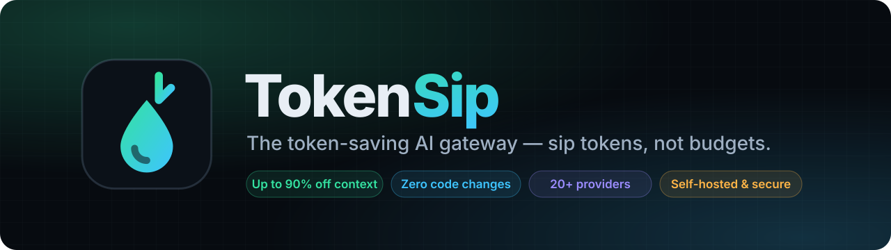
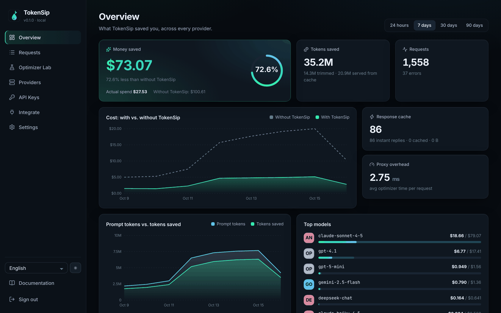

<div align="center">



<h3>خفّض فاتورة نماذج اللغة دون تغيير سلوك الذكاء الاصطناعي.</h3>

[English](README.md) · [فارسی](README.fa.md) · [Русский](README.ru.md) · **العربية** · [简体中文](README.zh-CN.md)

</div>

<div dir="rtl">

**TokenSip** بوابة مفتوحة المصدر وذاتية الاستضافة تقع بين تطبيقك ومزوّدي الذكاء الاصطناعي مثل **OpenAI وAnthropic وGemini وDeepSeek وأكثر من 20 مزوّدًا آخر**، فتزيد إصابات ذاكرة المطالبات المؤقتة إلى أقصى حد، وتحذف الرموز المهدرة، وتعرض لك كل دولار تم توفيره.



## لماذا TokenSip؟

ترسل الوكلاء البرمجية وتطبيقات الدردشة **المحادثة كاملة في كل دورة**. ويحتسب المزوّدون هذا السياق المكرر بـ **10–50% فقط من السعر العادي** عند استخدام التخزين المؤقت للمطالبات بشكل صحيح — لكن معظم التطبيقات لا تفعل ذلك. يقوم TokenSip بذلك تلقائيًا:

- 🧠 **مصمم للتخزين المؤقت:** يضيف نقاط `cache_control` لـ Anthropic ومفتاح `prompt_cache_key` لـ OpenAI تلقائيًا، وكل التحسينات «ثابتة البادئة» حتى تبقى الذاكرة المؤقتة فعّالة.
- 🪶 **بدون فقد أولًا:** ملف التعريف الافتراضي `safe` لا يغيّر ما يراه النموذج، والطلبات غير المعدّلة تُمرَّر **بايتًا ببايت**.
- 🎚️ **أنت تختار:** خمسة ملفات تعريف من `off` إلى `extreme` (نحو 10% من المطالبة الأصلية) مع تحذيرات واضحة من انخفاض الجودة.
- 🔌 **بلا تغيير في الكود:** غيّر العنوان الأساسي فقط. يعمل مع كل حزم SDK ومع Claude Code وCodex وGemini CLI وAider وCline.
- 🔐 **آمن وخاص:** خزنة مشفّرة، مفاتيح افتراضية بميزانيات، لا تخزين للمطالبات، مصادقة ثنائية، وCSP صارم.

## 🚀 البدء السريع

</div>

```bash
npx tokensip
```

```python
from openai import OpenAI

client = OpenAI(base_url="http://localhost:8787/v1", api_key="sk-...")
client.chat.completions.create(model="gemini-2.5-flash", messages=[...])  # يُوجَّه تلقائيًا إلى Google
```

```bash
# Docker
docker run -d -p 127.0.0.1:8787:8787 -e TOKENSIP_SECRET="$(openssl rand -hex 32)" \
  -v tokensip-data:/data ghcr.io/imrx44/tokensip:latest
```

<div dir="rtl">

## 🎚️ ملفات تعريف التوفير

| الملف | المطالبة المرسلة | خطر الجودة | الوظيفة |
| --- | --- | --- | --- |
| `off` | 100% | لا يوجد | وكيل خالص مع التحليلات والميزانيات |
| **`safe`** (افتراضي) | 95–100% | **لا يوجد** | نقاط التخزين المؤقت ومفاتيح التوجيه وإزالة المسافات |
| `balanced` | 70–95% | منخفض | + ضغط JSON للأدوات وإزالة مخرجات الأدوات المكررة |
| `aggressive` ⚠️ | 40–70% | متوسط | + اقتطاع المخرجات القديمة وحذف وسط المحادثات الطويلة |
| `extreme` ⚠️ | **نحو 10%** | **مرتفع** | + ميزانية السياق وتقليل التفكير وحد طول المخرجات |

## 🔌 نقاط النهاية

| المزوّد | العنوان الأساسي |
| --- | --- |
| الكل (توجيه تلقائي حسب اسم النموذج) | `http://localhost:8787/v1` |
| OpenAI | `http://localhost:8787/openai/v1` |
| Anthropic | `http://localhost:8787/anthropic` |
| Google Gemini | `http://localhost:8787/google` |
| DeepSeek وMistral وxAI وGroq وOpenRouter … | `http://localhost:8787/<provider>/v1` |

## 🔐 الأمان

- تشفير مفاتيح المزوّدين والردود المخزنة بـ AES-256-GCM
- مفاتيح افتراضية (`tsk_…`) بميزانية شهرية وحدود معدل وتاريخ انتهاء
- لا يتم تخزين المطالبات أو الردود — بيانات وصفية فقط
- رمز إعداد لمرة واحدة، scrypt، مصادقة ثنائية، حماية CSRF وسجل تدقيق

التفاصيل في [SECURITY.md](SECURITY.md) و[التوثيق](docs).

## 📄 الترخيص

[MIT](LICENSE) — إذا وفّر لك TokenSip المال، يرجى منح المستودع **⭐ نجمة**.

</div>
