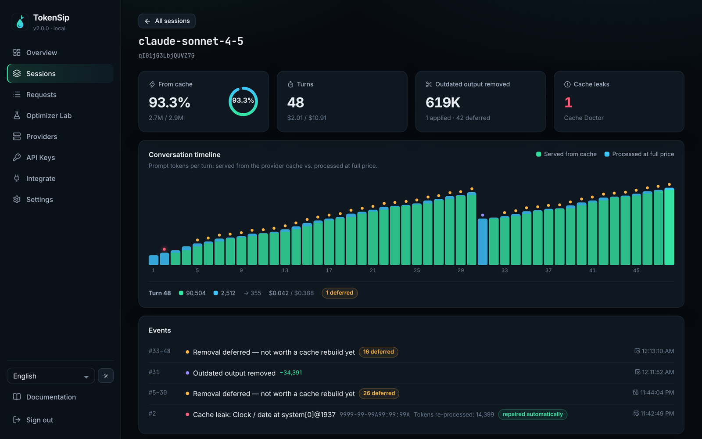

<div align="center">


<h3>هزینهٔ مدل‌های زبانی را کم کنید، بدون تغییر در رفتار هوش مصنوعی.</h3>

[English](README.md) · **فارسی** · [Русский](README.ru.md) · [العربية](README.ar.md) · [简体中文](README.zh-CN.md)

</div>

<div dir="rtl">

**TokenSip** یک درگاه (Gateway) متن‌باز و خودمیزبان است که بین برنامهٔ شما و ارائه‌دهندگان هوش مصنوعی مثل **OpenAI، Anthropic، Gemini، DeepSeek و بیش از ۲۰ ارائه‌دهندهٔ دیگر** قرار می‌گیرد، بیشترین استفاده را از کش پرامپت می‌کند، توکن‌های هدررفته را حذف می‌کند و تک‌تک دلارهای صرفه‌جویی‌شده را نشان می‌دهد.


## چرا TokenSip؟

ایجنت‌های برنامه‌نویسی و چت‌بات‌ها **در هر نوبت کل گفت‌وگو را دوباره ارسال می‌کنند**. ارائه‌دهندگان این متن تکراری را — اگر کش پرامپت درست استفاده شود — با **۱۰ تا ۵۰ درصد قیمت عادی** حساب می‌کنند؛ اما بیشتر برنامه‌ها این کار را نمی‌کنند. TokenSip این کار را خودکار انجام می‌دهد:

- 🧠 **آگاه به کش:** نقاط کش Anthropic و کلید `prompt_cache_key` در OpenAI را خودکار اضافه می‌کند. همهٔ بهینه‌سازی‌ها «پایدار در پیشوند» هستند تا کش در هر نوبت دوباره استفاده شود.
- 🪶 **امن برای ایجنت‌ها:** پروفایل پیش‌فرض `balanced` هیچ‌چیزی را که مدل هنوز لازم دارد حذف نمی‌کند: آخرین نسخهٔ هر فایل و خروجی هر دستور کامل می‌ماند و پیام‌های دستیار هرگز تغییر نمی‌کنند. پروفایل `safe` درخواست‌های بدون تغییر را **بایت‌به‌بایت** ارسال می‌کند.
- 🎚️ **انتخاب با شما:** پنج پروفایل از `off` تا `extreme` (حدود ۱۰٪ پرامپت اصلی) با هشدار روشن دربارهٔ افت کیفیت.
- 🔌 **بدون تغییر کد:** فقط آدرس پایه (Base URL) را عوض کنید. با همهٔ SDKها و ایجنت‌هایی مثل Claude Code، Codex، Gemini CLI، Aider و Cline کار می‌کند.
- 🔐 **امن و خصوصی:** خزانهٔ رمزنگاری‌شده، کلیدهای مجازی با بودجه، عدم ذخیرهٔ پرامپت، احراز هویت دومرحله‌ای و CSP سخت‌گیرانه.
- 📊 **با عدد و رقم:** داشبوردی که هزینهٔ واقعی را در کنار هزینهٔ «بدون TokenSip» نشان می‌دهد.

## 🧠 تازه در نسخهٔ ۲: موتور کانتکست با محاسبهٔ اقتصاد کش

همهٔ ابزارهای مدیریت کانتکست پرامپت را *کوچک‌تر* می‌کنند. اما با کش پرامپت این کار اغلب **ضرر** است: توکن‌های کش‌شده فقط ۱۰٪ قیمت دارند، پس حذف یک خروجی قدیمی در ابتدای یک جلسهٔ طولانی ایجنت، ارائه‌دهنده را مجبور می‌کند همه‌چیزِ بعد از آن را دوباره پردازش کند و با ۱۲۵٪ قیمت در کش بنویسد. در شبیه‌سازی ما، هرس‌کردن در هر نوبت هزینه را **۳۳ تا ۸۷ درصد بیشتر** از کش سادهٔ پرامپت کرد. هرس بر اساس حدس هم کدی را حذف می‌کند که ایجنت هنوز به آن نیاز دارد.

TokenSip 2 به‌جای آن دو سؤال دقیق‌تر می‌پرسد:

1. **آیا این اطلاعات قطعاً قدیمی شده است؟** فایلی که دوباره خوانده شده یا تستی که دوباره اجرا شده — نتیجهٔ جدیدتر وضعیت فعلی را نشان می‌دهد. فقط نسخهٔ قدیمی با اشاره‌گری به فراخوانی جدیدتر جایگزین می‌شود و آخرین مشاهده همیشه کامل می‌ماند؛ پس ایجنت هیچ‌وقت مجبور نمی‌شود چیزی را دوباره بخواند یا دوباره بسازد.
2. **آیا حذفش «همین حالا» ارزان‌تر از نگه‌داشتنش است؟** یک مدل سایه از کش ارائه‌دهنده تصمیم می‌گیرد: وقتی کش سرد است یا بازنویسی هزینهٔ خودش را جبران می‌کند (`S·r·H ≥ (C−p)·(w−r)`) اعمال می‌شود، وگرنه منتظر یک لحظهٔ رایگان می‌ماند. تغییرهای اعمال‌شده ثابت می‌مانند تا پیشوند از نوبت بعد دوباره کش شود.

**پزشک کش (Cache Doctor)** هم مقادیری را که بی‌صدا کش را خراب می‌کنند — ساعت یا شناسهٔ درخواست در پرامپت سیستمی، یا ابزارهایی که هر بار با ترتیب متفاوت فرستاده می‌شوند — پیدا و خودکار تعمیر می‌کند، بدون اینکه چیزی که مدل می‌بیند تغییر کند.

| ۷۲۰ نوبت یکسان ایجنت با قیمت‌گذاری کش Anthropic | کش ساده | هرس در هر نوبت | **TokenSip 2** |
| --- | --- | --- | --- |
| وقفه‌های طولانی‌تر از ۵ دقیقه | $33.00 | $43.85 (+32.9%) | **$22.82 (−30.9%)** |
| ساعت در پرامپت سیستمی | $161.96 | $46.41 (−71.3%) | **$23.86 (−85.3%)** |
| بدون وقفه | $20.77 | $38.87 (+87.2%) | **$18.72 (−9.9%)** |

خودتان اجرا کنید: `npx tokensip simulate`. در تست واقعی با یک ارائه‌دهنده، سهم توکن‌هایی که از کش خوانده شدند برای پرامپتی که ساعت داشت از **حدود ۴٪ به حدود ۹۶٪** رسید. [توضیح کامل طراحی (انگلیسی)](docs/cache-economics.md)



## 🚀 شروع سریع

</div>

```bash
npx tokensip
```

<div dir="rtl">

درگاه و داشبورد روی **http://localhost:8787** اجرا می‌شوند. در اولین اجرا، یک لینک راه‌اندازی یک‌بارمصرف در ترمینال چاپ می‌شود تا رمز مدیر را بسازید. سپس برنامه‌تان را به TokenSip وصل کنید:

</div>

```python
from openai import OpenAI

client = OpenAI(base_url="http://localhost:8787/v1", api_key="sk-...")
client.chat.completions.create(model="claude-sonnet-4-5", messages=[...])  # مسیریابی خودکار به Anthropic
```

```bash
# Docker
docker run -d -p 127.0.0.1:8787:8787 -e TOKENSIP_SECRET="$(openssl rand -hex 32)" \
  -v tokensip-data:/data ghcr.io/imrx44/tokensip:latest

# داشبورد نمایشی با دادهٔ مصنوعی (رمز: tokensip-demo)
npx tokensip demo
```

<div dir="rtl">

## 🎚️ پروفایل‌های صرفه‌جویی

| پروفایل | پرامپت ارسالی | ریسک کیفیت | کارکرد |
| --- | --- | --- | --- |
| `off` | ۱۰۰٪ | هیچ | پراکسی خالص با تحلیل، بودجه و کش پاسخ |
| `safe` | ۹۵–۱۰۰٪ | **هیچ** | نقاط کش پرامپت، کلید مسیریابی کش، ترتیب پایدار ابزارها، حذف فاصله‌های اضافه |
| **`balanced`** (پیش‌فرض) | ۷۰–۹۵٪ | کم | + تعمیرهای پزشک کش، حذف خروجی‌های قدیمی ابزار با زمان‌بندی اقتصادی، حذف خروجی‌های تکراری ابزار |
| `aggressive` ⚠️ | ۴۰–۷۰٪ | متوسط | + فشرده‌سازی JSON، کوتاه‌سازی خروجی‌های قدیمی و حذف میانهٔ گفت‌وگوهای خیلی طولانی |
| `extreme` ⚠️ | **حدود ۱۰٪** | **زیاد** | + بودجهٔ کانتکست، کاهش استدلال و محدودیت طول خروجی |

پروفایل‌های همراه با افت در داشبورد نیاز به تأیید دارند و هر درخواست با افت، هدر `x-tokensip-warning` برمی‌گرداند.

**نتایج اندازه‌گیری‌شده** روی نمونه‌های ایجنت در `examples/requests`: پروفایل `balanced` حدود **۴۲ درصد** و `extreme` حدود **۸۹ تا ۹۱ درصد** توکن پرامپت را کاهش داد.

## 🔌 اندپوینت‌ها

| ارائه‌دهنده | آدرس پایه |
| --- | --- |
| همه (مسیریابی خودکار بر اساس نام مدل) | `http://localhost:8787/v1` |
| OpenAI | `http://localhost:8787/openai/v1` |
| Anthropic | `http://localhost:8787/anthropic` |
| Google Gemini | `http://localhost:8787/google` |
| DeepSeek، Mistral، xAI، Groq، OpenRouter و … | `http://localhost:8787/<provider>/v1` |
| Ollama، LM Studio، vLLM (محلی) | `http://localhost:8787/ollama/v1` |

## 🤖 ایجنت‌ها

</div>

```bash
export ANTHROPIC_BASE_URL=http://localhost:8787/anthropic      # Claude Code
export GOOGLE_GEMINI_BASE_URL=http://localhost:8787/google     # Gemini CLI
aider --openai-api-base http://localhost:8787/v1               # Aider
```

<div dir="rtl">

TokenSip برای ایجنت‌ها نامرئی است: هرگز پیام‌های دستیار را بازنویسی نمی‌کند، تا پیش از `aggressive` قالب خروجی ابزارها را تغییر نمی‌دهد تا ویرایش دقیق فایل‌ها خراب نشود، فقط خروجی‌هایی را حذف می‌کند که خواندن جدیدترِ همان فایل یا دستور جایشان را گرفته و همهٔ استریم‌ها را بدون تأخیر عبور می‌دهد.

## 🔐 امنیت

- رمزنگاری کلیدهای ارائه‌دهنده و کش پاسخ با AES-256-GCM
- کلیدهای مجازی (`tsk_…`) با بودجهٔ ماهانه، محدودیت نرخ و تاریخ انقضا
- عدم ذخیرهٔ پرامپت و پاسخ — فقط فراداده (مدل، توکن، هزینه)
- توکن راه‌اندازی یک‌بارمصرف، رمزنگاری scrypt، احراز هویت دومرحله‌ای، محافظت CSRF و گزارش رویدادها

جزئیات کامل در [SECURITY.md](SECURITY.md) و [مستندات انگلیسی](docs).

## 📄 مجوز

[MIT](LICENSE) — اگر TokenSip به کارتان آمد، لطفاً به مخزن **⭐ ستاره** بدهید.

</div>
