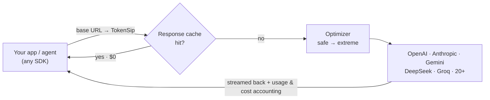
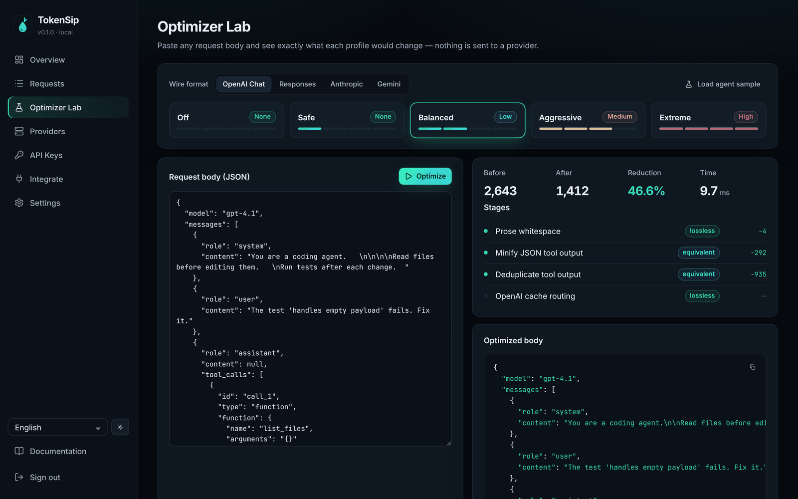
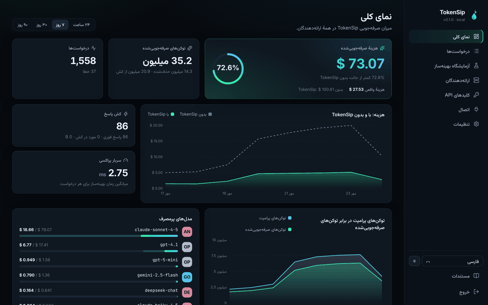
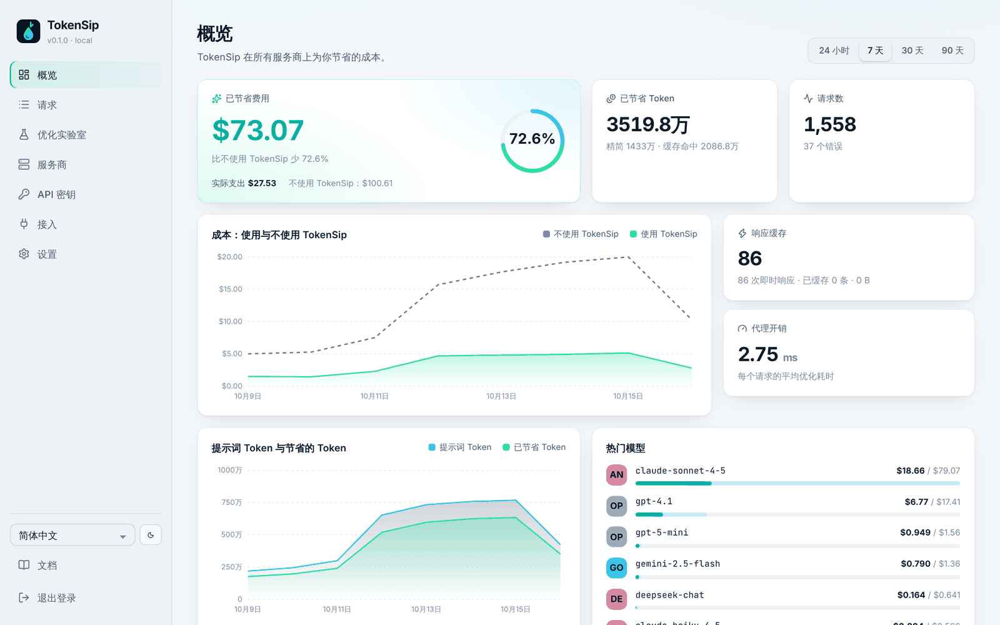
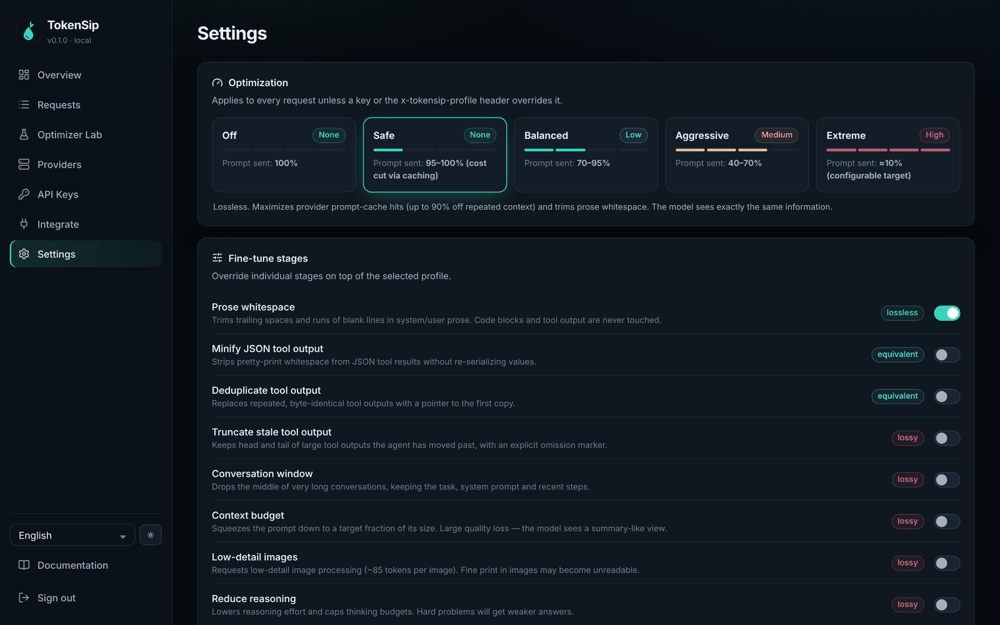
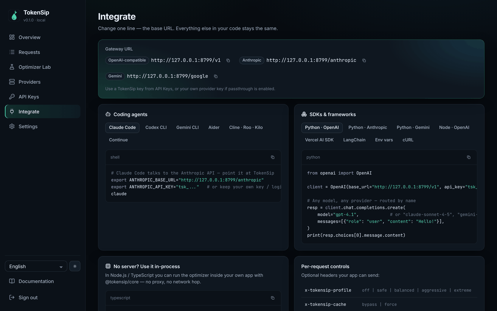

<div align="center">


<h3>Cut your LLM bill without changing how your AI behaves.</h3>

A self-hosted, drop-in gateway for **OpenAI, Anthropic, Gemini, DeepSeek and 20+ providers**<br/>
that maximizes prompt-cache hits, trims wasted tokens and shows you every dollar saved.

[](https://github.com/IMRX44/tokensip/actions/workflows/ci.yml)
[](https://github.com/IMRX44/tokensip/actions/workflows/codeql.yml)
[](LICENSE)
[](https://nodejs.org)
[](https://github.com/IMRX44/tokensip/pkgs/container/tokensip)
[](CONTRIBUTING.md)

**English** · [فارسی](README.fa.md) · [Русский](README.ru.md) · [العربية](README.ar.md) · [简体中文](README.zh-CN.md)

[Quick start](#-quick-start) · [How it saves](#-how-it-saves-money) · [Profiles](#%EF%B8%8F-savings-profiles) · [Providers](#-providers--endpoints) · [Agents](#-works-with-your-agents) · [Security](#-security) · [Docs](docs)

</div>

---


## Why TokenSip?

Coding agents and chat apps **re-send the entire conversation on every turn**.
A 30-step agent session pays for the same system prompt, tool definitions and
file contents dozens of times. Providers will bill that repeated context at
**10–50% of the normal price** if you use prompt caching correctly — but most
apps and frameworks don't.

TokenSip sits between your code and your providers and fixes that for you:

- 🧠 **Cache-aware by design.** Adds Anthropic `cache_control` breakpoints and stable OpenAI `prompt_cache_key`s automatically, and every optimization is *prefix-stable* so caches keep hitting turn after turn.
- 🪶 **Lossless first.** The default `safe` profile never changes what the model sees. Unchanged requests are forwarded **byte-for-byte**.
- 🎚️ **You choose the trade-off.** Five profiles from `off` to `extreme` (≈10% of the original prompt), with clear quality warnings for every lossy step.
- 🔌 **Zero code changes.** Swap one base URL. Works with every OpenAI, Anthropic and Gemini SDK, and with Claude Code, Codex, Gemini CLI, Aider, Cline, Continue …
- 🔐 **Secure & private.** Encrypted key vault, virtual keys with budgets, no prompts stored, 2FA, strict CSP. Runs on your laptop or your server.
- 📊 **Proof, not promises.** A dashboard that shows actual cost vs. what you *would* have paid — per model, per key, per request.

## 🚀 Quick start

```bash
npx tokensip
```

That's it — the gateway and dashboard run on **http://localhost:8787**. On first
start, the terminal prints a one-time setup link to create your admin password.

Then point your app at TokenSip:

```python
from openai import OpenAI

client = OpenAI(base_url="http://localhost:8787/v1", api_key="sk-...")  # your key works as-is locally

client.chat.completions.create(model="gpt-4.1", messages=[...])            # → OpenAI
client.chat.completions.create(model="claude-sonnet-4-5", messages=[...])  # → Anthropic
client.chat.completions.create(model="gemini-2.5-flash", messages=[...])   # → Google
```

<details>
<summary><b>🐳 Docker</b></summary>

```bash
docker run -d --name tokensip -p 127.0.0.1:8787:8787 \
  -e TOKENSIP_SECRET="$(openssl rand -hex 32)" \
  -e TOKENSIP_ADMIN_PASSWORD="choose-a-long-passphrase" \
  -e OPENAI_API_KEY -e ANTHROPIC_API_KEY \
  -v tokensip-data:/data \
  ghcr.io/imrx44/tokensip:latest
```

Or `docker compose up -d` with the hardened [`docker-compose.yml`](docker-compose.yml).
More in the [deployment guide](docs/deployment.md) (Caddy, nginx, systemd, Kubernetes).
</details>

<details>
<summary><b>🛠️ From source</b></summary>

```bash
git clone https://github.com/IMRX44/tokensip && cd tokensip
npm install && npm run build
node packages/server/dist/cli.js start
```
</details>

<details>
<summary><b>🧪 Just want to look around?</b></summary>

```bash
npx tokensip demo      # dashboard with 30 days of synthetic traffic — password: tokensip-demo
```
</details>

<details>
<summary><b>📦 Inside your Node.js app, without a server</b></summary>

```ts
import OpenAI from "openai";
import { createTokenSipFetch } from "@tokensip/core";

const client = new OpenAI({ fetch: createTokenSipFetch({ profile: "balanced" }) });
```
</details>

## 💸 How it saves money



| Lever | What TokenSip does | Typical effect |
| --- | --- | --- |
| **Provider prompt caching** | Adds Anthropic cache breakpoints, sets OpenAI `prompt_cache_key`, keeps prefixes byte-stable | Repeated context billed at **10%** (Anthropic) / **10–50%** (OpenAI, DeepSeek, Gemini) |
| **Lossless trimming** | Prose whitespace, pretty-printed JSON tool output, repeated tool results | **40–50% fewer prompt tokens** on agent transcripts (`balanced`) |
| **Response cache** | Identical deterministic requests answered from an encrypted per-key cache | **$0**, answered in milliseconds |
| **Lossy budgets** *(opt-in)* | Context budget, history window, reasoning & output caps | Prompt down to **≈10%** (`extreme`) |

Measured with `npx tokensip optimize` on the agent transcripts in [`examples/requests`](examples/requests):

| Request | `safe` | `balanced` | `extreme` |
| --- | --- | --- | --- |
| OpenAI coding agent (14.1k tokens) | −0.1% · cache-key routing | **−48.5%** | **−90.8%** ⚠️ |
| Anthropic coding agent (5.3k tokens) | −0.3% · 4 cache breakpoints | **−42.2%** | **−89.1%** ⚠️ |

> `safe` barely shortens the prompt on purpose: its job is to make the provider bill the repeated part at a fraction of the price, with **zero** change to what the model sees.

Optimizer overhead is typically **under 1 ms** for `safe` and a few milliseconds for `balanced` on a 14k-token agent request.

## 🎚️ Savings profiles

| Profile | Prompt sent | Quality risk | What it does |
| --- | --- | --- | --- |
| `off` | 100% | none | Pure proxy — analytics, budgets and response cache only |
| **`safe`** *(default)* | 95–100% | **none** | Prompt-cache breakpoints & routing keys, prose whitespace. Byte-exact passthrough otherwise |
| `balanced` | 70–95% | low | + JSON tool output minified, repeated tool results replaced by pointers |
| `aggressive` ⚠️ | 40–70% | medium | + stale tool output truncated, middle of very long chats dropped, low-detail images |
| `extreme` ⚠️ | **≈10%** | **high** | + context budget (configurable ratio), lower reasoning effort, output cap |

Set it globally in the dashboard, per virtual key, or per request with
`x-tokensip-profile: balanced`. Lossy profiles require confirmation in the UI and
every lossy request returns an `x-tokensip-warning` header.
→ [Every stage explained](docs/optimizations.md)



## 🔌 Providers & endpoints

Use the auto-routing endpoint (`/v1`, routes by model name) or a provider-specific one:

| Provider | OpenAI format | Native format |
| --- | --- | --- |
| OpenAI | `http://localhost:8787/openai/v1` | — |
| Anthropic | `http://localhost:8787/anthropic/v1` | `http://localhost:8787/anthropic` |
| Google Gemini | `http://localhost:8787/google/v1` | `http://localhost:8787/google` |
| DeepSeek | `http://localhost:8787/deepseek/v1` | `http://localhost:8787/deepseek` (Anthropic format) |
| Mistral · xAI Grok · Groq · OpenRouter · Together · Fireworks · Cerebras · Perplexity · Cohere · Qwen | `http://localhost:8787/<id>/v1` | — |
| Moonshot Kimi · Z.ai GLM | `http://localhost:8787/<id>/v1` | `http://localhost:8787/<id>` (Anthropic format) |
| Azure OpenAI · any OpenAI-compatible API | `http://localhost:8787/p/<provider>/v1` | — |
| Ollama · LM Studio · vLLM (local) | `http://localhost:8787/ollama/v1` … | — |

Provider keys can be added in the dashboard (encrypted at rest) or picked up from
the environment (`OPENAI_API_KEY`, `ANTHROPIC_API_KEY`, `GEMINI_API_KEY`, `DEEPSEEK_API_KEY`, …).

## 🤖 Works with your agents

<table>
<tr><td><b>Claude Code</b></td><td>

```bash
export ANTHROPIC_BASE_URL=http://localhost:8787/anthropic
```
</td></tr>
<tr><td><b>Codex CLI</b></td><td>

```toml
# ~/.codex/config.toml
model_provider = "tokensip"
[model_providers.tokensip]
name = "TokenSip"
base_url = "http://localhost:8787/openai/v1"
env_key = "TOKENSIP_API_KEY"
wire_api = "responses"
```
</td></tr>
<tr><td><b>Gemini CLI</b></td><td>

```bash
export GOOGLE_GEMINI_BASE_URL=http://localhost:8787/google
```
</td></tr>
<tr><td><b>Aider · Cline · Roo · Continue · LangChain · Vercel AI SDK · LiteLLM</b></td><td>

Any "OpenAI-compatible base URL" setting → `http://localhost:8787/v1` ([examples](docs/integrations.md))
</td></tr>
</table>

TokenSip is built to be invisible to agents: it never rewrites assistant turns
(signed thinking blocks stay valid), never reformats tool output in `safe` mode
(exact-match file edits keep working), keeps tool calls paired with their results,
streams every chunk as it arrives and returns errors in your SDK's own format.

## 🔐 Security

| | |
| --- | --- |
| **Encrypted vault** | Provider keys and cached responses are encrypted with AES-256-GCM. Keys are never returned by the API. |
| **Virtual keys** | Give each app a `tsk_…` key with a monthly budget, rate limit, expiry and provider allow-list. Stored only as hashes. |
| **No prompt storage** | Only metadata (model, tokens, cost, latency) is logged. Never prompts or completions. |
| **Locked-down dashboard** | One-time setup token (no default password), scrypt, TOTP 2FA, CSRF tokens, `SameSite=Strict` cookies, strict CSP, audit log. |
| **Safe defaults** | Binds to `127.0.0.1`; `server` mode disables key passthrough and enables HSTS; Docker image is non-root and read-only friendly. |

Read the full [security model](SECURITY.md).

## 🌍 Dashboard in 5 languages

English · فارسی · Русский · العربية · 简体中文 — with full right-to-left layout, local number and date formats, and light & dark themes.

<table>
<tr>
<td></td>
<td></td>
</tr>
<tr>
<td></td>
<td></td>
</tr>
</table>

## ⚙️ Configuration

| Variable | Default | |
| --- | --- | --- |
| `TOKENSIP_MODE` | `local` | `server` = no key passthrough, binds `0.0.0.0`, HSTS |
| `TOKENSIP_PORT` | `8787` | |
| `TOKENSIP_SECRET` | auto-generated | Master encryption key (`openssl rand -hex 32`) |
| `TOKENSIP_ADMIN_PASSWORD` | — | Skip the setup-token flow |
| `TOKENSIP_PROFILE` | `safe` | `off` · `safe` · `balanced` · `aggressive` · `extreme` |
| `TOKENSIP_DATA_DIR` | `~/.tokensip` | SQLite database (built into Node — nothing to install) |

All options, CLI commands and headers: [docs/configuration.md](docs/configuration.md).

| Request header | Response header |
| --- | --- |
| `x-tokensip-profile` — override the profile | `x-tokensip-tokens-saved` — tokens trimmed |
| `x-tokensip-cache: bypass \| force` | `x-tokensip-cache: HIT \| MISS \| BYPASS` |
| `x-tokensip-provider` — force a provider | `x-tokensip-warning` — lossy optimization applied |

## 🆚 How is this different?

| | TokenSip | Generic LLM gateways | Prompt compressors |
| --- | --- | --- | --- |
| Optimizes for provider **prompt caching** | ✅ automatic | ⚠️ manual | ⚠️ rewrites can break it |
| Lossless by default, byte-exact passthrough | ✅ | ✅ | ❌ |
| Agent-safe (thinking blocks, tool pairing, exact edits) | ✅ | ✅ | ⚠️ |
| Opt-in aggressive compression down to ≈10% | ✅ with warnings | ❌ | ✅ |
| Native Anthropic & Gemini APIs (no translation) | ✅ | ⚠️ varies | — |
| "Cost without TokenSip" baseline per request | ✅ | ❌ | ❌ |
| Single command, no database server, no Python | ✅ | ⚠️ | ⚠️ |

## 🗺️ Roadmap

- [ ] Semantic response cache (embedding similarity, opt-in)
- [ ] Automatic fallbacks and load balancing across keys
- [ ] Gemini explicit context caching for very large prefixes
- [ ] Per-team usage reports and CSV export
- [ ] Python package (`pip install tokensip`) for in-process optimization
- [ ] More dashboard languages — [help translate](CONTRIBUTING.md#translations)!

## 🤝 Contributing

Issues and PRs are very welcome — especially new provider presets, optimizer
ideas and translations. Start with [CONTRIBUTING.md](CONTRIBUTING.md).

```bash
git clone https://github.com/IMRX44/tokensip && cd tokensip
npm install && npm run build && npm test
```

If TokenSip saves you money, **please ⭐ star the repo** — it helps others find it.

## 📄 License

[MIT](LICENSE) © IMRX44

<div align="center">
<sub>Keywords: LLM gateway · AI proxy · token optimization · prompt caching · OpenAI proxy · Claude proxy · Gemini proxy · LLM cost reduction · AI agents · self-hosted</sub>
</div>
