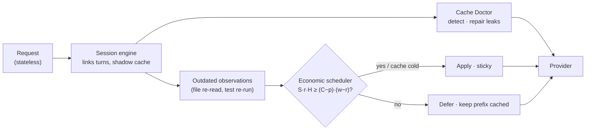

# The Cache-Economic Context Engine

TokenSip 2 treats a coding agent's context as an **economic object**: every token
in it has a price that depends on where it sits relative to the provider's prompt
cache. This page explains why, and what the engine does about it.

## The problem with "make the context smaller"

Agents re-send the whole conversation on every turn. The obvious fix is to make
that context smaller — prune old tool output, summarize, compress. Every context
manager does some version of it. With prompt caching, this is often a **loss**:

| Anthropic pricing (relative to normal input) | |
| --- | --- |
| Reading a cached prefix | **0.1×** |
| Writing a prefix into the cache (5-minute TTL) | **1.25×** |
| Uncached input | 1× |

Delete one stale file read near the *start* of a 100k-token conversation and
everything after it no longer matches the cache. The provider re-processes —
and re-writes — ~100k tokens at 1.25× to save a few thousand tokens at 0.1×.
Do that on every turn and the "optimization" costs more than doing nothing.
In the simulator below, when no cache leak is involved, naive pruning every turn
is **+33% to +87% more expensive** than plain caching.

The second problem is quality: tools that prune context by guessing what is
"no longer needed" sometimes remove code the agent still relies on. It then
re-reads files, re-derives work, or edits against content it can no longer see.

## The idea

TokenSip 2 never asks "is this token needed?" It asks two narrower questions:

1. **Is this information provably outdated?** — only then may it be removed.
2. **Is removing it *now* cheaper than keeping it, given the cache?** — only
   then is it removed now; otherwise it waits for a moment when removal is free.

And because many cache misses are not caused by context growth at all but by
**cache leaks** — a clock in the system prompt, tools serialized in a different
order — it finds and repairs those automatically.



## 1 · Session engine and shadow cache

API calls are stateless, so TokenSip links them into conversations: a session is
identified by the tenant, wire format, model and first user message. For each
session it keeps a **shadow** of what the provider has cached — the block hashes
of the last request *as actually sent* (after repairs) and when it was sent.

- **Warm or cold.** The prefix is assumed cached for 5 minutes after the last
  turn (Anthropic's TTL, refreshed on every read). After a coffee break the cache
  is cold, and any rewrite is free.
- **Calibrated by the provider.** Every response's usage (`cache_read_input_tokens`,
  `cached_tokens`, …) updates an observed cache ratio. If a provider reports no
  cache reads at all after a few turns, the engine stops protecting a cache that
  doesn't exist.
- **Bounded.** Sessions live in memory with an LRU limit and idle expiry. Nothing
  about the prompt is persisted — only counts and leak *shapes* (below).

## 2 · Removing only what is provably outdated

An **observation** is a tool call that reads state without changing it:

| Kind | Recognized from |
| --- | --- |
| File read | `read_file`, `view`, `Read`, `open` … with a `path`/`file_path`; shell `cat`, `nl -ba`, `head`/`tail -n`, `sed -n 'a,bp'` |
| Command | Read-only shell commands: `ls`, `grep`/`rg`, `git status/diff/log/show`, test runners (`npm test`, `pytest`, `go test`, `cargo test`, `vitest run` …), type checkers and linters |
| Query | Search, list, fetch and status tools |

Tools whose name says they *change* something (`write`, `edit`, `patch`,
`delete`, `commit`, `install`, …) and shell commands outside the read-only list
are never observations.

When the **same resource is observed again later** — the file was re-read after
an edit, the test suite was re-run — the earlier result is outdated by
definition: the newer one shows the current state. Only then does TokenSip
replace the older result with a tombstone that points at the newer call:

```text
[TokenSip · superseded] This earlier read_file result for src/server.ts is outdated:
the same file was observed again later (call toolu_07), and that newer result shows
the current state. ~4,812 tokens removed.
```

Invariants (property-tested over thousands of random multi-turn sessions):

- The **latest** observation of every resource is always kept verbatim.
- A full read supersedes earlier partial reads of the same file — never the reverse.
- An **error** result never supersedes real content.
- Byte-identical repeats are left to `dedupe-tool-results`, which keeps the
  *earliest* copy (cache-friendlier).
- Assistant turns are never edited (signed thinking blocks stay valid), and
  every tool call stays paired with its result.
- Every removed token is recoverable by following the pointer chain to the newer call.

Because nothing the model needs disappears — it still sees the current version
of every file and the latest output of every command — agents don't re-read or
re-derive work.

## 3 · The economic scheduler

Suppose `S` tokens of outdated output are pending removal, the first of them at
token position `p`, and the provider currently caches the prompt up to `C`.
With read price `r` and write price `w` (relative to normal input) and an
expected `H` remaining turns:

```text
savings    = S · r · H              # the pending tokens, read from cache on every remaining turn
extra cost = (C − p) · (w − r)      # one-off: everything after p is re-written instead of read
```

| Situation | Decision |
| --- | --- |
| Cache is cold (first turn, or idle > TTL) | **Apply** — free |
| The region after `p` is being re-sent anyway (`C ≤ p`) | **Apply** — free |
| `savings ≥ extra cost` | **Apply** — pays back |
| Otherwise | **Defer** — keep the prefix cached and wait for a free moment |

`H` grows with the length of the session (long sessions are likely to continue),
capped at 30. `r` and `w` come from the price book (Anthropic `0.1 / 1.25`;
providers with automatic caching like OpenAI and DeepSeek have no write surcharge).

Once applied, a removal is **sticky** for the rest of the session: every later
request carries the same tombstone, so the new prefix is byte-stable and cached
from then on. Deferred removals don't flip-flop.

## 4 · Cache Doctor

Before deciding anything, the engine compares the new request with the shadow of
the previous one. When something early in the prompt changed while the rest
stayed the same, that's a **cache leak**: the provider re-processes everything
after it on every turn.

| Leak | Typical cause | Repair (balanced and above) |
| --- | --- | --- |
| Clock / date · ID · counter in the system prompt | `Current time: 2026-10-17T10:00:07Z`, a request id | **relocate-volatile**: the system prompt keeps a stable placeholder; the current value is appended to the newest user message, so the model still sees it |
| Tool order · JSON key order | Frameworks and MCP clients that build the tool list from a hash map | **stabilize-tools**: tools are sent in a canonical order and serialization |
| Tool set changed · text edit | The app really changed its prompt | Reported, not repaired |

Only the leak's **shape** is stored (digits → `9`, letters → `a`/`A`, e.g.
`9999-99-99A99:99:99A`) — never prompt text. The dashboard's *Cache Doctor*
card groups leaks by kind, location and shape, with the tokens they cost.

Earlier relocated values are re-attached to their original user messages on
every later turn, so the conversation history stays byte-identical and cacheable.

## Results

### Simulator

`npx tokensip simulate` replays the same synthetic coding-agent sessions
(12 sessions × 60 turns: file reads, edits, re-reads, test runs, idle gaps)
through each strategy and bills them with Anthropic's cache rules:

| Scenario | No caching | Plain caching (v1) | Naive pruning every turn | **TokenSip 2** |
| --- | --- | --- | --- | --- |
| With coffee breaks > 5 min | $134.43 | $33.00 | $43.85 (+32.9%) | **$22.82 (−30.9%)** |
| Clock in the system prompt (`--clock`) | $134.45 | $161.96 | $46.41 (−71.3%) | **$23.86 (−85.3%)** |
| No breaks (`--no-breaks`) | $129.59 | $20.77 | $38.87 (+87.2%) | **$18.72 (−9.9%)** |

Percentages are relative to plain caching. Note the second row: with a clock in
the system prompt, prompt caching makes things *more* expensive than no caching
at all — every turn writes a fresh cache entry at 1.25× that is never read.

### Live

Through a real provider (Chat Completions API), a 5-turn conversation whose
system prompt contains a clock:

| Profile | Prompt tokens read from cache per turn, once warm |
| --- | --- |
| `safe` (v1 behavior) | ≈241 of ≈4,200 (**~6%**) |
| `balanced` (TokenSip 2) | ≈4,209 of ≈4,300 (**~96%**) |

A second live test reads a file, edits it and reads it again. With the outdated
read replaced by a tombstone, the real model still answered from the current
content (`now=250 before=100`). Reproduce with `npm run test:live` (see
[`v2.live.ts`](../packages/server/test/live/v2.live.ts)).

## Seeing it work

- Response headers: `x-tokensip-session` (the conversation id) and
  `x-tokensip-cache-leak` (e.g. `timestamp at system[0]@1937`).
- Dashboard → **Sessions**: per-turn timeline of cached vs. full-price prompt
  tokens, leaks, and every *applied* / *deferred* decision.
- `GET /api/sessions` and `GET /api/sessions/:id` ([API](api.md)).

## Related work

Context editing and pruning exist elsewhere — Anthropic's server-side context
editing, gateway-side compressors with on-demand expansion, and agent plugins
that drop old tool output. TokenSip 2 differs in three ways: removal is limited to
*provably outdated* observations, every change is **scheduled against the
provider's cache economics** instead of applied eagerly, and cache leaks are
**detected and repaired automatically** rather than left to the app developer.
