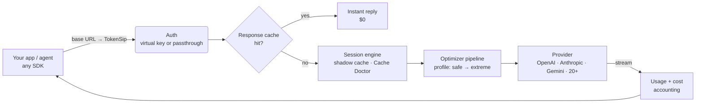

# How TokenSip works

TokenSip is a reverse proxy that speaks the native wire formats of the major
LLM APIs. It never translates between formats — an Anthropic request stays an
Anthropic request — so every provider feature (tools, vision, thinking,
citations, structured output, streaming) keeps working.

## Request lifecycle

1. **Route.** The path picks the wire format (`/chat/completions`, `/responses`,
   `/v1/messages`, `:generateContent`). The provider comes from the route
   (`/anthropic/...`, `/groq/v1/...`), the `x-tokensip-provider` header, or the
   model name (`claude-*` → Anthropic, `gemini-*` → Google, `gpt-*` → OpenAI, …).
2. **Authenticate.** A TokenSip key (`tsk_…`) is swapped for the provider key
   from the encrypted vault. In passthrough mode, the client's own credential is
   forwarded untouched — including OAuth tokens.
3. **Enforce limits.** Per-key rate limits, monthly budgets, provider allow-lists.
4. **Link the session.** The request is matched to its conversation. The engine
   compares it with what the provider has cached from the previous turn, flags
   cache leaks and decides — on cache economics — whether pending removals of
   outdated tool output should happen now or wait ([details](cache-economics.md)).
5. **Optimize.** The request runs through the stages of the active profile.
   If nothing changed, the **original bytes** are forwarded.
6. **Cache.** Deterministic requests (`temperature: 0`) are looked up in the
   encrypted, per-key response cache.
7. **Stream.** The response is streamed back chunk-by-chunk while usage is
   parsed on the side. If TokenSip asked an OpenAI-compatible provider for
   stream usage, the extra usage-only chunk is removed before your app sees it.
8. **Account.** Billed tokens, prompt-cache reads/writes, tokens trimmed, actual
   cost and *baseline* cost (what the same call would have cost without
   TokenSip and without caching) are recorded — never the prompt itself. The
   provider's reported cache reads calibrate the session's shadow cache.

## Why "prefix-stable" matters

Providers bill repeated prompt prefixes at a steep discount (Anthropic: 10% of
the input price, OpenAI/DeepSeek/Gemini: 10–50%). Agents re-send the entire
conversation on every turn, so **most of an agent's bill is a prefix the
provider has already seen**.

A naive "prompt compressor" rewrites earlier messages differently on each turn,
which silently breaks prefix caching and can make you pay *more*. Every
TokenSip stage is deterministic and prefix-stable: the rewrite of message *i*
depends only on messages *0…i*. The optimized conversation on turn *n + 1*
starts with exactly the bytes sent on turn *n*, so caches keep hitting.

TokenSip 2 goes one step further. Some changes *should* rewrite history —
removing a file read that a later read made outdated, for example. Those are
scheduled: applied when the cache is cold or the rewrite pays for itself, and
deferred otherwise. Once applied they are sticky, so the new prefix is stable
again from the next turn. See [Cache economics](cache-economics.md).

## Packages

| Package | Purpose |
| --- | --- |
| [`@tokensip/core`](../packages/core) | The optimizer pipeline, session engine, protocol adapters, usage parsers, price book, provider catalog and cost simulator. Zero HTTP dependencies — embed it anywhere. |
| [`tokensip`](../packages/server) | The gateway: Fastify server, SQLite storage (`node:sqlite`), vault, admin API, CLI and bundled dashboard. |
| `@tokensip/web` | The dashboard (React + Vite), served by the gateway. |

## Performance

TokenSip runs on the request path, so it is built to stay out of the way:

- prepared SQLite statements, cached provider and key lookups, and request logs
  written in batches — no per-request disk writes on the hot path;
- token *reports* use sampled counting for large texts (within a few percent of
  exact), and counts are memoized: agents re-send the same tool output every
  turn, so it is only counted once; billing numbers always come from the provider;
- the session engine fingerprints each message once per request and only
  canonicalizes the blocks that changed since the previous turn;
- streams are forwarded chunk by chunk and finish the moment the provider sends
  its end-of-stream event; streaming bodies are only buffered when they can be
  cached.

`npm run bench` sends a real 51 KB (~14k-token) coding-agent request to a local
mock provider, directly and through TokenSip, with the gateway in its own process.
Results on a single core (Node 22), session tracking included:

| Path | Added latency (p50, concurrency 1) | Throughput (concurrency 32) |
| --- | ---: | ---: |
| `off` | +1.9 ms | 525 req/s |
| `safe` | +2.4 ms | 427 req/s |
| `balanced` | +2.3 ms | 398 req/s |
| `aggressive` | +2.8 ms | 344 req/s |
| `extreme` | +2.8 ms | 309 req/s |

Most of the `off` baseline is Node's HTTP stack receiving and re-sending a
51 KB body; TokenSip's own logic is about half a millisecond of it. The
benchmark repeats one request, so memoized token counts hit — as they do for the
history an agent re-sends on every turn.
