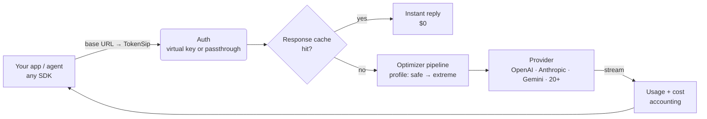

# How TokenSip works

TokenSip is a reverse proxy that speaks the native wire formats of the major
LLM APIs. It never translates between formats — an Anthropic request stays an
Anthropic request — so every provider feature (tools, vision, thinking,
citations, structured output, streaming) keeps working.

## Request lifecycle

1. **Route.** The path picks the wire format (`/chat/completions`, `/responses`,
   `/v1/messages`, `:generateContent`). The provider comes from the route
   (`/anthropic/...`, `/groq/v1/...`), the `x-tokensip-provider` header, or the
   model name (`claude-*` → Anthropic, `gemini-*` → Google, `gpt-*` → OpenAI, …).
2. **Authenticate.** A TokenSip key (`tsk_…`) is swapped for the provider key
   from the encrypted vault. In passthrough mode, the client's own credential is
   forwarded untouched — including OAuth tokens.
3. **Enforce limits.** Per-key rate limits, monthly budgets, provider allow-lists.
4. **Optimize.** The request runs through the stages of the active profile.
   If nothing changed, the **original bytes** are forwarded.
5. **Cache.** Deterministic requests (`temperature: 0`) are looked up in the
   encrypted, per-key response cache.
6. **Stream.** The response is streamed back chunk-by-chunk while usage is
   parsed on the side. If TokenSip asked an OpenAI-compatible provider for
   stream usage, the extra usage-only chunk is removed before your app sees it.
7. **Account.** Billed tokens, prompt-cache reads/writes, tokens trimmed, actual
   cost and *baseline* cost (what the same call would have cost without
   TokenSip and without caching) are recorded — never the prompt itself.

## Why "prefix-stable" matters

Providers bill repeated prompt prefixes at a steep discount (Anthropic: 10% of
the input price, OpenAI/DeepSeek/Gemini: 10–50%). Agents re-send the entire
conversation on every turn, so **most of an agent's bill is a prefix the
provider has already seen**.

A naive "prompt compressor" rewrites earlier messages differently on each turn,
which silently breaks prefix caching and can make you pay *more*. Every
TokenSip stage is deterministic and prefix-stable: the rewrite of message *i*
depends only on messages *0…i*. The optimized conversation on turn *n + 1*
starts with exactly the bytes sent on turn *n*, so caches keep hitting.

## Packages

| Package | Purpose |
| --- | --- |
| [`@tokensip/core`](../packages/core) | The optimizer pipeline, protocol adapters, usage parsers, price book and provider catalog. Zero HTTP dependencies — embed it anywhere. |
| [`tokensip`](../packages/server) | The gateway: Fastify server, SQLite storage (`node:sqlite`), vault, admin API, CLI and bundled dashboard. |
| `@tokensip/web` | The dashboard (React + Vite), served by the gateway. |
